<div align="center">


# Shiva Gallery

**A mobile-first online store for women's fashion, with a full admin panel. Built with Django and Next.js.**

Formal and office *manteaus*, *abayas*, blouses and trousers for Shiva Gallery, a boutique in Dezful, Iran.<br/>
Fully Persian and right-to-left. Nothing in the code is specific to this shop: the name, logo, colors, categories, shipping and return rules all come from the admin panel, so the same code can run any clothing store.


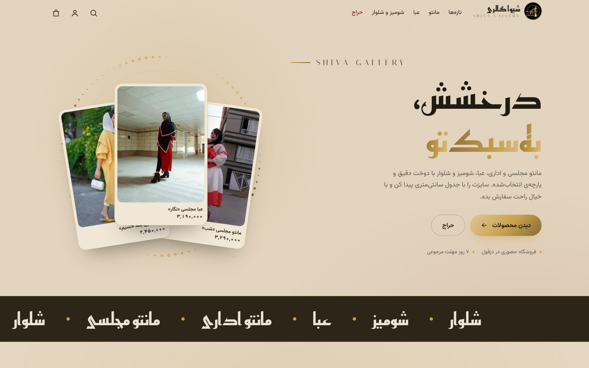

</div>

## Contents

- [Screenshots](#screenshots)
- [Features](#features)
- [Tech stack](#tech-stack)
- [Getting started](#getting-started)
- [Configuration](#configuration)
- [Project structure](#project-structure)
- [API overview](#api-overview)
- [How it works](#how-it-works)
- [Testing](#testing)
- [Deployment](#deployment)
- [Roadmap](#roadmap)
- [Credits](#credits)

## Screenshots

### Storefront (mobile)

Almost all customers arrive on a phone, so the storefront is designed for mobile first and then scaled up to desktop.

<table>
  <tr>
    <td align="center" width="33%"><br/><sub><b>Home</b>: animated hero with featured products</sub></td>
    <td align="center" width="33%">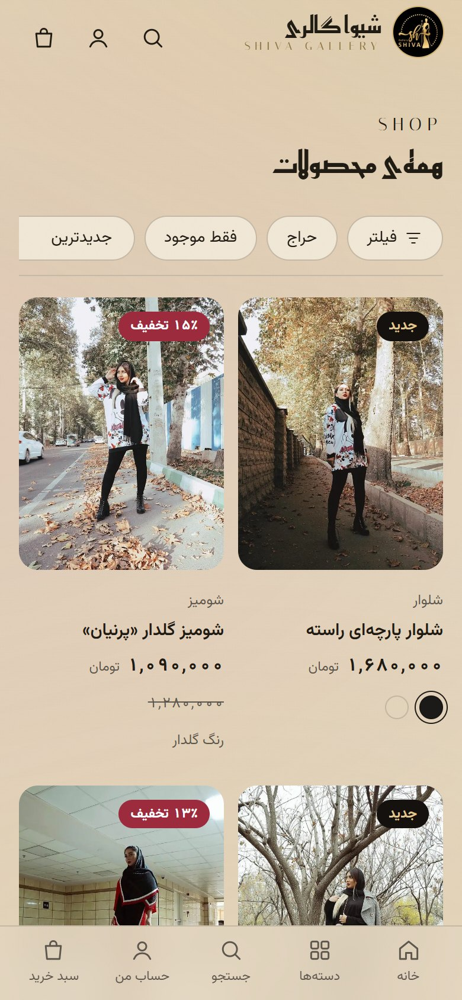<br/><sub><b>Shop</b>: filters, sale and new badges, color swatches</sub></td>
    <td align="center" width="33%">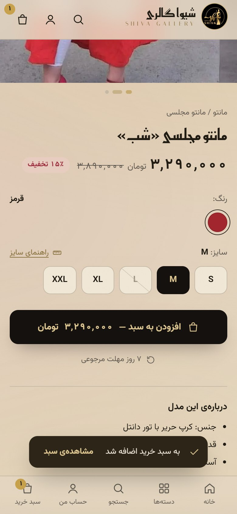<br/><sub><b>Product</b>: color and size picker, size guide, sale price</sub></td>
  </tr>
  <tr>
    <td align="center">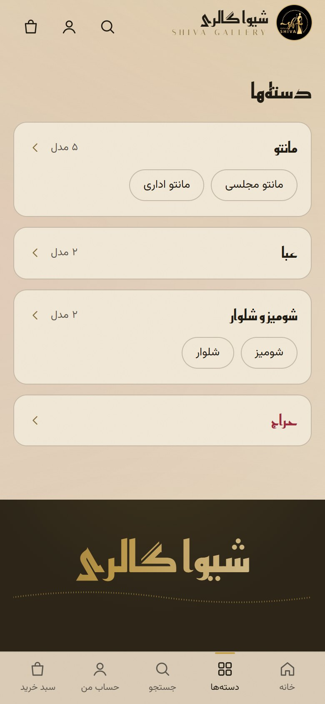<br/><sub><b>Categories</b>: nested categories with product counts</sub></td>
    <td align="center">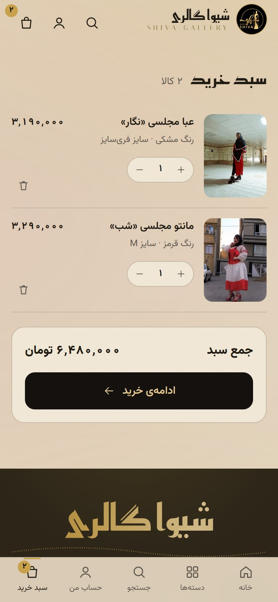<br/><sub><b>Cart</b>: guest cart, no sign-up needed</sub></td>
    <td align="center">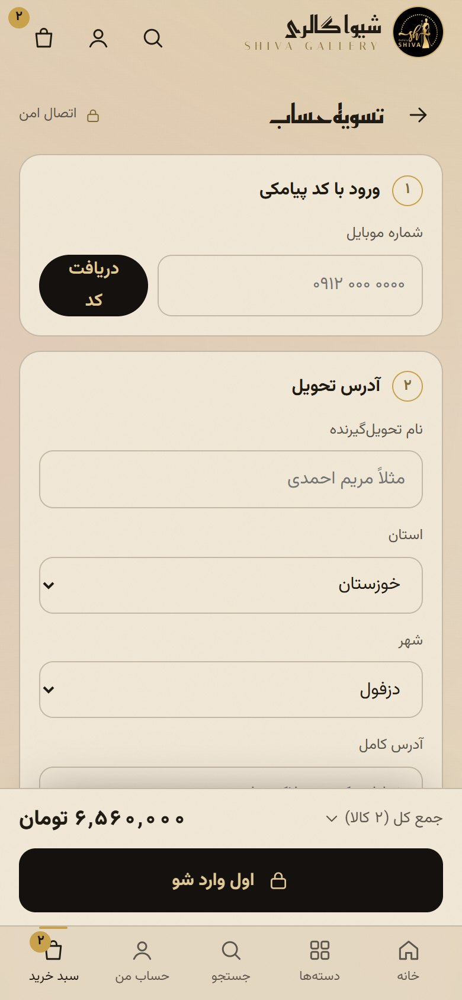<br/><sub><b>Checkout</b>: one page, sign-in with an SMS code</sub></td>
  </tr>
</table>

### Admin panel (desktop)

The shop owner works from a computer, so the panel at `/panel` is designed for desktop and still works on a phone.

| Dashboard | Orders |
|---|---|
| 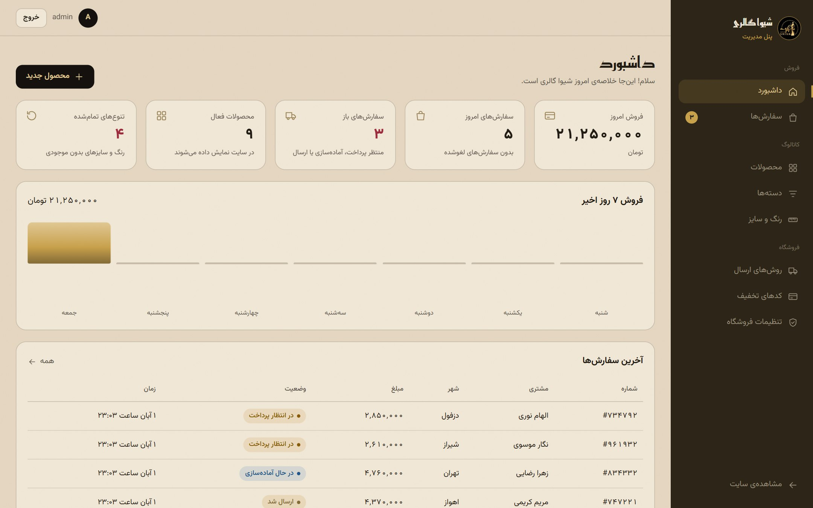 | 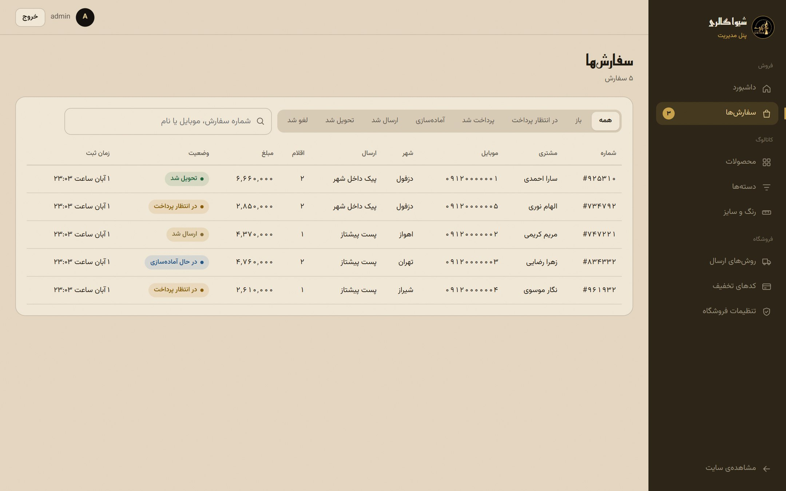 |
| **Order detail** | **Products** |
| 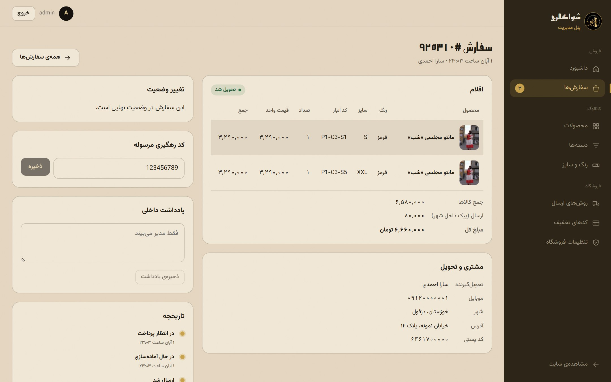 | 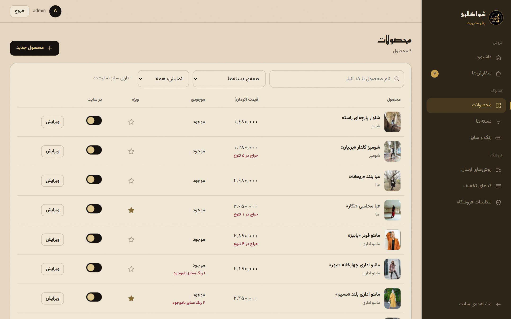 |
| **Colors, sizes and availability** | **Store settings** |
| 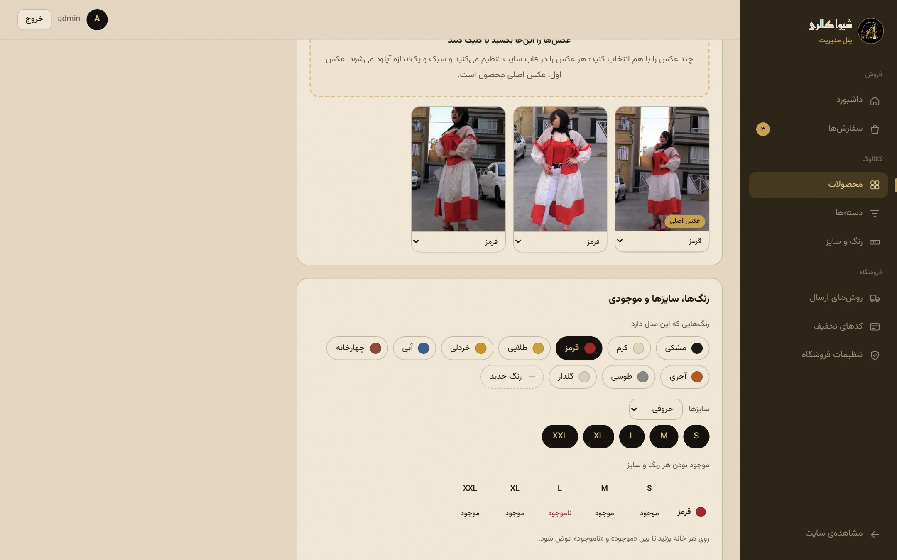 | 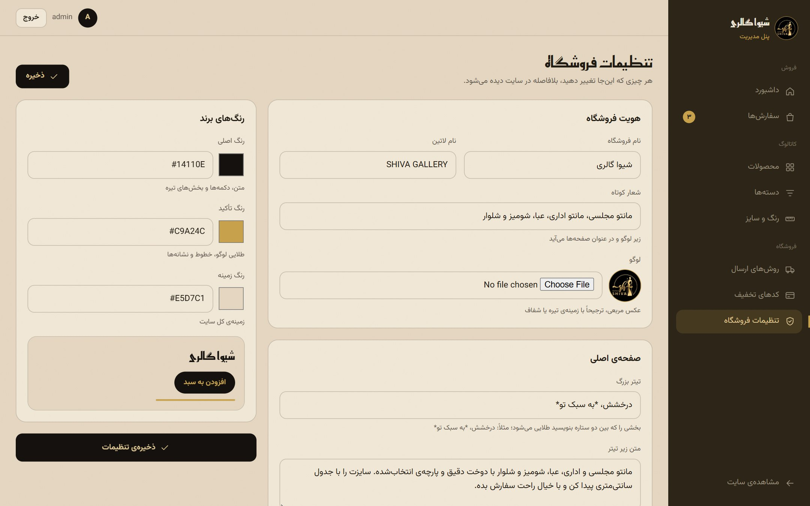 |

## Features

### For customers

- **Browse and filter.** Nested categories, a full shop page, and filters for color, size, price range, in-stock and on-sale, with sorting. Filters live in the URL, so any filtered view can be shared.
- **Product page.** A swipeable gallery that switches photos with the selected color, size buttons that show which sizes are unavailable, a per-category size chart, and the regular and sale price with the discount percentage.
- **Search** across product names.
- **Guest cart.** No account is needed to shop. The cart is kept in the browser, and prices and availability are checked again on the server at checkout.
- **One-page checkout.** Sign in with a mobile number and an SMS code, with no passwords. Then pick a province and city, choose a shipping method, apply a discount code and place the order. The order summary stays pinned to the bottom of the screen.
- **Order tracking** with an order number and mobile number, without signing in, plus an account page that lists past orders.
- **Account.** Name, saved addresses (add, edit, remove) and favorites. Each signed-in customer has their own cart on a shared device.
- **Favorites, back-in-stock SMS and reviews.** A heart on every product page; a sold-out size can be picked to get one SMS when it is back; customers who received a product can rate and review it, shown after the owner approves.
- **Returns.** Within the store's return window, the customer asks to return or exchange chosen items from the order page and follows the answer there.
- **SEO.** Pages are rendered on the server, product pages include `schema.org` product data, and private pages (cart, checkout, panel) are marked `noindex`.

### For the shop owner

- **Dashboard.** Today's online and in-store sales, open orders, returns and reviews waiting, out-of-stock variants, a 7-day sales chart and the latest orders.
- **Shop till (`/panel/pos`).** Ring up in-store sales from the same stock the site sells: search or scan a product code, build a ticket, give a discount, take cash, card, card transfer or a mix, and print an 80 mm receipt. Typing the customer's mobile recognises a returning customer.
- **In-store returns and exchanges.** Find the earlier ticket by its number or the customer's mobile and pick the pieces coming back. They go back on sale at what the customer paid for them (after that ticket's discount). Pieces taken in exchange go on the same ticket, so it settles the difference either way; a negative total is money handed back. Sellers keep to the store's return window and exchange-only policy; the owner may make exceptions.
- **Closing the till.** At night the system works out the cash that should be in the drawer (the morning's cash, plus the day's net cash, minus expenses paid from the drawer). The seller counts it, and the difference is recorded. What stays in the drawer starts the next day. Voiding a sale needs its own permission.
- **Users and access.** Besides the owner (admin), panel users sign in with their own username and password. Under "Users and access" the owner ticks, for each user, which parts of the panel they see and what they may do in each (for example sell but not void, see stock but not purchase prices), starting from ready-made sets such as "seller" and "stock keeper". Hidden parts leave the menu and the server refuses them too.
- **Orders.** Filter by status and date range, export to Excel (CSV), search by number, phone or name, and move each order through its lifecycle. Every status change sends the customer an SMS. The owner can add a parcel tracking code and private notes and see the full status history. Cancelling an order returns its items to stock automatically.
- **Products.** Photos are dragged in and cropped to the site's 3:4 frame in the browser, then stored on the server as WebP at a fixed 1200×1600. Each photo can be tied to a color. Each color × size variant can be marked available or unavailable, with its own price and sale price. A price can be applied to everything at once, or to one whole color or size.
- **Categories.** A category tree with a size system and size chart per category. Subcategories inherit both.
- **Colors and sizes.** Named color swatches and size systems (letter sizes, numeric sizes, one-size).
- **Shipping methods** with a fixed fee per method, optionally limited to a single city (for example, local courier only within Dezful).
- **Discount codes.** Percentage (with an optional cap) or fixed amount, with a minimum order, start and end dates and a usage limit.
- **Store settings.** Name, logo, slogan, a ready-made theme (warm day or golden night), home page text, contact details and return policy. Changes appear on the site right away. The admin panel always keeps its own light theme so it stays readable.
- **Customers.** One profile per mobile number, joining site orders and shop purchases: totals, favorite sizes, colors and categories, saved and used addresses, returns, reviews, favorites, a private note, and an Excel export. It doubles as a customer club: the shop registers old customers or ones who have not bought yet, can disable a customer (no sale online or at the till), and keeps each customer's birthday. With the birthday discount on, a customer gets it once a year, from three days before to three days after their birthday: automatically at checkout, and with one button at the till. It never adds up with a discount code; the larger one applies.
- **Profit and expenses.** Each product has a purchase price, saved on every sold line at the time of sale. The report shows a profit and loss statement (sales, returns, cost of goods, expenses by category), daily sales, best sellers, slow movers and sales per category and seller. Running costs are entered under "Expenses".
- **Home page and banners.** The owner picks and orders the products on the turning ring, and runs campaigns: picture banners on the home page and a text line above every page, each with optional start and end times.

## Tech stack

| Layer | Technology |
|---|---|
| Backend | Python 3.12+, Django 5.2, Django REST Framework, django-filter, Pillow |
| Frontend | Next.js 15 (App Router, Turbopack), React 19, TypeScript, CSS Modules |
| Database | SQLite in development, PostgreSQL in production |
| SMS | Pluggable: console output in development, [Melipayamak](https://www.melipayamak.com/) in production |
| Fonts | Vazirmatn, Reem Kufi and Italiana (all OFL), bundled with the project |

There's no Docker, Celery or Redis. The project runs as two plain processes on Linux or Windows.

## Getting started

### Prerequisites

- Python **3.12 or newer**
- Node.js **20 or newer**

### 1. Backend

```bash
cd backend
python -m venv .venv

# Windows
.venv\Scripts\pip install -r requirements.txt
copy .env.example .env
.venv\Scripts\python manage.py migrate
.venv\Scripts\python manage.py seed_demo          # optional: demo categories, products and photos
.venv\Scripts\python manage.py createsuperuser    # the admin panel login

# Linux / macOS: use .venv/bin/ instead of .venv\Scripts\ and cp instead of copy
```

### 2. Frontend

```bash
cd frontend
npm install
copy .env.example .env.local      # Linux / macOS: cp .env.example .env.local
```

### 3. Run

On Windows, one script starts both servers in separate windows:

```powershell
.\dev.ps1
```

Or start them yourself:

```bash
# terminal 1
cd backend && .venv/bin/python manage.py runserver 127.0.0.1:8000
# terminal 2
cd frontend && npm run dev
```

| What | URL |
|---|---|
| Storefront | http://localhost:3100 |
| Admin panel | http://localhost:3100/panel |
| REST API | http://127.0.0.1:8000/api/ |
| Django admin (backup tool) | http://127.0.0.1:8000/admin/ |

> [!TIP]
> In development, SMS messages are printed in the backend terminal instead of being sent. Use the code printed there to sign in at checkout.

> [!NOTE]
> The dev server compiles each page the first time it's opened, so the first click on a page can take a few seconds. A production build (`npm run build` and then `npm start`) doesn't have this delay.

## Configuration

### Backend: `backend/.env`

| Variable | Default | Description |
|---|---|---|
| `DJANGO_DEBUG` | `true` | Set to `false` in production. |
| `DJANGO_SECRET_KEY` | none | Required when debug is off. |
| `DJANGO_ALLOWED_HOSTS` | `localhost,127.0.0.1` | Comma-separated host names. |
| `DJANGO_CSRF_TRUSTED_ORIGINS` | `http://localhost:3100,…` | Origins allowed to post forms, meaning the storefront's address. |
| `CORS_ALLOWED_ORIGINS` | `http://localhost:3100,…` | Origins allowed to call the API from the browser. |
| `TIME_ZONE` | `Asia/Tehran` | |
| `DB_ENGINE` | `sqlite` | `sqlite` or `postgresql`. PostgreSQL also needs `DB_NAME`, `DB_USER`, `DB_PASSWORD`, `DB_HOST`, `DB_PORT` and the `psycopg` driver. |
| `MEDIA_ROOT` | `backend/media` | Where uploaded photos are stored. |
| `SMS_BACKEND` | `console` | `console` prints messages, `melipayamak` sends them. |
| `SMS_USERNAME`, `SMS_API_KEY` | none | Melipayamak panel username and API key. The key is sent in place of the password. |
| `SMS_PATTERN_*` | none | Approved Melipayamak pattern codes (`bodyId`), one for each of the seven message types. The shared service line sends only approved patterns, never free text. Suggested texts are in `deploy/sms-patterns.md`. |
| `PAYMENT_GATEWAY` | `none` | `none`, `fake` (local testing only) or `zarinpal`. |
| `ZARINPAL_MERCHANT_ID`, `ZARINPAL_SANDBOX` | none, `false` | Zarinpal merchant and test mode. |
| `SITE_URL` | `http://localhost:3100` | The storefront's address. The payment gateway sends customers back here. |
| `BACKUP_DIR` | `backups/` next to `backend/` | Where `manage.py backup` writes its zips. |
| `THROTTLE_AUTH`, `THROTTLE_TRACK` | `20/hour`, `30/hour` | Rate limits for sign-in codes and order tracking. |

### Frontend: `frontend/.env.local`

| Variable | Description |
|---|---|
| `NEXT_PUBLIC_API_URL` | The API address as seen from the browser. |
| `INTERNAL_API_URL` | The API address as seen from the Next.js server. It can be an internal address. |

## Project structure

```
ShivaGallery/
├── backend/                 Django project
│   ├── config/              settings and URL routing
│   ├── apps/
│   │   ├── core/            store settings (a single row): name, brand, texts, policies
│   │   ├── catalog/         colors, size systems, category tree, products, photos, variants
│   │   ├── inventory/       append-only stock ledger
│   │   ├── accounts/        phone sign-in with SMS codes, staff login, provinces and cities
│   │   ├── orders/          shipping methods, discount codes, checkout, orders and their history
│   │   └── panel/           admin panel API (staff only)
│   └── demo/                demo data and photos used by `seed_demo`
├── frontend/                Next.js app
│   └── src/
│       ├── app/             routes: storefront pages and /panel
│       ├── components/      UI by area (product, listing, cart, checkout, panel, …)
│       └── lib/             API client, types, formatting
├── docs/                    decisions, page map, brand assets, screenshots (in Persian)
├── tools/promo/             records story-style promo videos of the site on a phone
└── dev.ps1                  starts both servers on Windows
```

## API overview

All endpoints are under `/api/`.

**Public**

| Endpoint | Purpose |
|---|---|
| `GET store/` | Store settings and branding |
| `GET categories/` | Category tree with product counts |
| `GET facets/` | Colors and sizes for filters |
| `GET products/` | Product list. Filters: `category`, `color`, `size`, `min_price`, `max_price`, `in_stock`, `on_sale`, `featured`, `search`, `ordering`, `page` |
| `GET products/<slug>/` | Product detail with variants, sizes, size chart and category path |
| `GET shipping-methods/` | Shipping methods and fees |
| `POST cart/validate/` | Re-check cart prices and availability |
| `POST checkout/quote/` | Totals including shipping and discount |
| `GET POST orders/` | The signed-in customer's orders, or place a new order |
| `GET orders/<number>/` | One order |
| `POST orders/track/` | Track an order by number and phone, without signing in |
| `POST auth/otp/request/`, `auth/otp/verify/` | Send and check an SMS sign-in code |
| `GET auth/me/`, `POST auth/profile/`, `auth/logout/` | Session and profile |

**Admin** (staff only, under `/api/admin/`)

`dashboard/`, `store/`, `products/` (including photo upload and reordering, and the variant matrix), `product-images/`, `variants/`, `categories/`, `colors/`, `size-systems/`, `shipping-methods/`, `discounts/`, `orders/`, `stock-movements/`.

## How it works

- **Stock is a ledger.** A variant's stock is the sum of an append-only list of movements: sales, cancellations and manual changes. Every change goes through one function, which locks the variant row, so two shoppers can't buy the last item at the same time. A database constraint also stops stock from going negative. The panel currently shows only *available* and *unavailable*. The full ledger is still recorded and can be shown again.
- **Prices are whole tomans.** Each variant can have its own price and sale price. A sale price must be lower than the regular price, and product cards show the cheapest variant.
- **Orders keep a snapshot.** Each order stores the address, prices, product names and photos as they were at the time of purchase, so later edits to a product don't change past orders. Status changes follow a fixed set of allowed transitions and are recorded in the order's history.
- **One store, many possible stores.** All store-specific data lives in one settings model. The store picks one of a few ready-made themes; each sets every color, checked for contrast, so no combination of picked colors can make the site unreadable. More themes are added in `globals.css`.
- **Readable Persian URLs.** Product and category slugs are in Persian, for example `/p/مانتو-مجلسی-شب`.
- **Fonts are bundled.** Google Fonts isn't reliable from inside Iran, so the fonts ship with the project and are split by script. Persian pages download only the Persian part.

## Testing

```bash
cd backend
.venv\Scripts\python manage.py test        # Linux / macOS: .venv/bin/python manage.py test

cd frontend
npx tsc --noEmit                           # type-check
npm run lint
```

The backend suite covers the catalog, filters, checkout, discounts, stock, orders, SMS sign-in and the admin API.

## Deployment

1. Use PostgreSQL. Set `DB_ENGINE=postgresql`, fill in the `DB_*` variables and run `pip install psycopg`.
2. Set `DJANGO_DEBUG=false`, a strong `DJANGO_SECRET_KEY`, and your real domain in `DJANGO_ALLOWED_HOSTS`, `DJANGO_CSRF_TRUSTED_ORIGINS` and `CORS_ALLOWED_ORIGINS`.
3. Run Django behind a WSGI server such as Gunicorn, and serve `MEDIA_ROOT` through the web server.
4. Build the frontend with `npm run build`, then run it with `npm start`. The backend must be reachable while the frontend builds.
5. Set `SMS_BACKEND=melipayamak` with the account and pattern IDs.

## Roadmap

- [x] Online payment through Zarinpal. Waiting for Zarinpal to approve the merchant.
- [x] Wishlist and "notify me when it's back in stock".
- [x] Customer reviews and ratings from verified buyers, with admin approval.
- [x] Daily database backups (`manage.py backup`).
- [x] Live SMS through Melipayamak. The API key is set and the seven patterns are approved.
- [ ] Production server and domain.

## Credits

- Demo product photos come from Wikimedia Commons under CC0 and CC BY-SA 2.0. See [backend/demo/photos/CREDITS.md](backend/demo/photos/CREDITS.md) for each author and license.
- Fonts: Vazirmatn, Reem Kufi and Italiana, under the SIL Open Font License.

Designed and developed by **[Houshiva](https://houshiva.ir)** · Erfan Mohammadi

All rights reserved. This repository has no open-source license.
